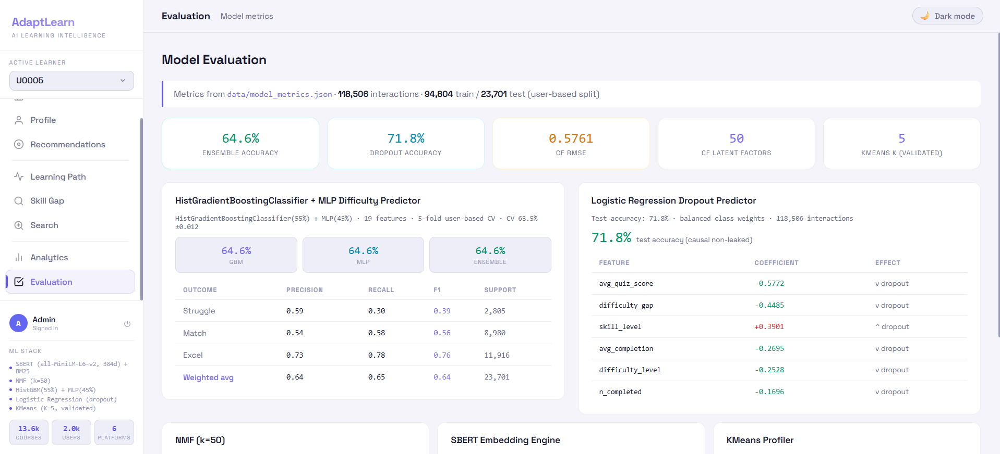
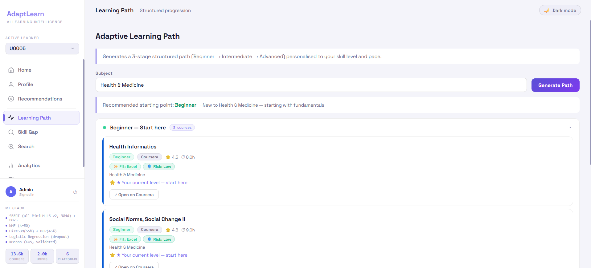
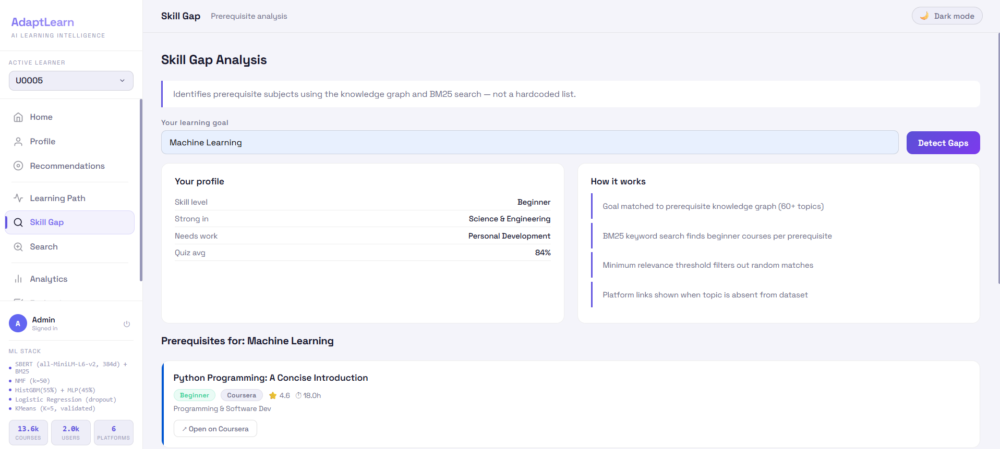
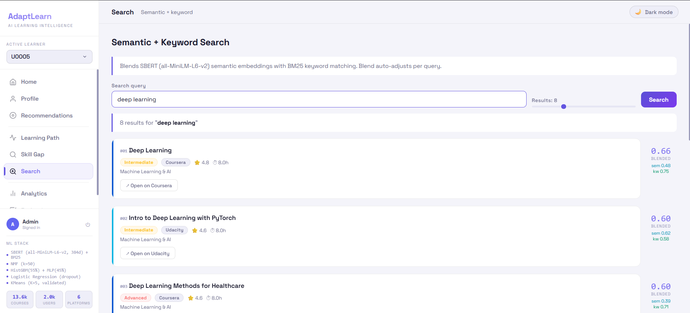

# AdaptLearn AI

[](https://www.python.org/)
[](https://fastapi.tiangolo.com/)
[](https://scikit-learn.org/)
[](https://huggingface.co/sentence-transformers/all-MiniLM-L6-v2)
[](LICENSE)

> **A multi-stage adaptive course recommendation engine** unifying 13,618 courses across 6 e-learning platforms with live student modelling, cognitive difficulty prediction, and dropout risk interception — served over a FastAPI backend at sub-100 ms latency.

---

## Table of Contents

1. [Why This Exists](#1-why-this-exists)
2. [What Makes It Different](#2-what-makes-it-different)
3. [Platform Walkthrough & Interface](#3-platform-walkthrough--interface)
4. [System Architecture](#4-system-architecture)
5. [Machine Learning Pipeline](#5-machine-learning-pipeline)
6. [Performance Metrics](#6-performance-metrics)
7. [Data Splits & Training Strategy](#7-data-splits--training-strategy)
8. [Project Structure](#8-project-structure)
9. [Setup & Installation](#9-setup--installation)
10. [API Reference](#10-api-reference)
---

## 1. Why This Exists

Most learners on e-learning platforms abandon courses within the first two weeks. The core problem isn't lack of content — Coursera, Udemy, edX, and their peers have more courses than any person could ever watch. The problem is **fit**: wrong difficulty, wrong prerequisite chain, wrong pacing for the learner's existing skill level.

Existing recommenders on these platforms use collaborative filtering in isolation. That works for warm users with hundreds of interactions, but it cold-starts badly and never tells you *why* a course is recommended or whether you're likely to finish it.

This project is a full-stack adaptive learning engine that answers three questions simultaneously:

1. **What should I learn next?** — Hybrid CF + semantic recommendation with a 5-step warm-up ramp
2. **Can I handle it?** — HistGBM + MLP difficulty classification against the learner's ability profile
3. **Will I finish it?** — Logistic regression dropout risk estimation with proactive intervention

---

## 2. What Makes It Different

| Feature | Standard CF Recommender | This System |
|---|---|---|
| Cold-start handling | Random / popularity fallback | Semantic (SBERT) + BM25 weighted blend |
| Difficulty awareness | None | 3-class HistGBM + MLP classifier per candidate |
| Prerequisite gating | None | Topological DAG with bridge-course injection |
| Dropout prediction | None | Per-student logistic regression risk score |
| Out-of-catalog queries | Error / empty | Federated live links to 6 platforms |
| Typo handling | None | O(1) dict correction + "Did you mean?" UI |
| Warm-up transition | Hard threshold switch | 5-step linear α-ramp (smooth, no jump) |
| Explainability | Black box | Per-recommendation skill-gap + rationale |

The smooth warm-up ramp is worth highlighting: instead of flipping from "content-based" to "collaborative" at a fixed interaction threshold (which causes visible recommendation jumps), the weight on CF increases by +0.20 per interaction over five steps: α(n) = n/5 for 0 ≤ n < 5, then pure NMF-CF at n ≥ 5.

---

## 3. Platform Walkthrough & Interface

### Model Evaluation & Diagnostic Analytics
The built-in evaluation interface surfaces live offline-evaluation benchmarks across 118,506 interactions (94,804 train / 23,701 test). It displays 3-class precision/recall/F1 distributions for the HistGBM + MLP ensemble, along with causal non-leaked feature coefficients for the logistic regression dropout model.


*Figure 1: Live Model Evaluation Dashboard displaying 64.6% ensemble difficulty accuracy, 71.8% dropout prediction accuracy, CF RMSE (0.5761), and feature coefficient weights.*

---

### Adaptive Learning Path (Multi-Stage Progression)
Generates personalized 3-stage learning curricula (`Beginner → Intermediate → Advanced`) matching the student's evaluated baseline mastery. Each course card integrates real-time cognitive outcome predictions (`Fit: Match/Excel/Struggle`) and proactive dropout risk alerts (`Risk: Low/Medium/High`).


*Figure 2: Personalized 3-stage progression path generated for learner `U0005` in Health & Medicine, displaying baseline calibration and automated fit diagnostic tags.*

---

### Skill Gap Analysis & Prerequisite Gating
Maps target learning goals against a curated topological knowledge graph of 60+ fundamental topics. When gaps are detected, the system automatically retrieves beginner bridge courses via BM25 lexical ranking before recommending advanced enrollments.


*Figure 3: Prerequisite diagnostic for "Machine Learning", identifying prerequisite requirements and surfacing beginner bridge modules.*

---

### Dual-Retrieval Semantic & Keyword Search
Real-time hybrid search blending SBERT dense vector retrieval (`all-MiniLM-L6-v2`, 384 dimensions) with Okapi BM25 keyword matching, with dynamic scoring calibration to prevent keyword saturation.


*Figure 4: Hybrid search execution displaying query-time calibrated blend scores (`blended`, `sem`, `kw`) across 13,618 unified courses.*

---

## 4. System Architecture

The pipeline has three layers that execute sequentially per recommendation request:

```
REQUEST
  │
  ▼
┌──────────────────────────────────────────────────────┐
│  LAYER 1 — Candidate Generation  (~8 ms)             │
│                                                      │
│  SBERT dense retrieval (all-MiniLM-L6-v2, 384-dim)  │
│    → cosine similarity over 13,618 embeddings        │
│    → Top-300 semantic candidates                     │
│                                                      │
│  BM25 lexical retrieval (k1=1.5, b=0.75)             │
│    → term-frequency weighted match over titles +     │
│      descriptions                                    │
│    → Top-150 keyword candidates                      │
│                                                      │
│  Union → deduplicate → ~120 candidates               │
└────────────────────┬─────────────────────────────────┘
                     │
                     ▼
┌──────────────────────────────────────────────────────┐
│  LAYER 2 — Ranking & Personalisation  (~25 ms)       │
│                                                      │
│  n = user interaction count                          │
│                                                      │
│  n = 0  →  0.70·sem + 0.20·bm25 + 0.10·pop          │
│  n < 5  →  linear α-ramp, α(n) = n/5                │
│  n ≥ 5  →  NMF-CF (k=50, RMSE=0.5761)               │
│                                                      │
│  Zero-CF guard: if CF_max < 1e-6 → semantic fallback │
│                                                      │
│  Subject mastery gate: completed courses filtered    │
│  Exponential time-decay on interactions (λ=0.005)   │
└────────────────────┬─────────────────────────────────┘
                     │
                     ▼
┌──────────────────────────────────────────────────────┐
│  LAYER 3 — Cognitive Diagnostic Layer  (~35 ms)      │
│                                                      │
│  Difficulty Fit:  HistGBM + MLP ensemble             │
│    → 19 features, 94,804 training samples            │
│    → batch inference: 120 candidates as one 2D       │
│      tensor (120×19), single forward pass            │
│    → 3-class output: Struggle / Match / Excel        │
│                                                      │
│  Dropout Risk:  Logistic Regression                  │
│    → binary classification on engagement features   │
│    → 71.8% accuracy (non-leaked split)               │
│                                                      │
│  Prerequisite Gate: DAG topological sort             │
│    → missing prerequisites → bridge-course injection │
└────────────────────┬─────────────────────────────────┘
                     │
                     ▼
              JSON RESPONSE
```

**Out-of-catalog path:** if the top semantic score < 0.42, the system skips ranking entirely and returns federated search links to Coursera, Udemy, edX, Udacity, FutureLearn, and Simplilearn. This threshold was calibrated against false-positive queries (e.g., "ancient Egyptian hieroglyphics" returning Photoshop results due to keyword overlap).

---

## 5. Machine Learning Pipeline

### 4.1 Difficulty Predictor — HistGBM + MLP Ensemble

**File:** [`adaptive_engine.py`](adaptive_engine.py)

Predicts whether a given learner will **Struggle**, **Match**, or **Excel** in a target course, based on 19 features combining learner history (average rating given, completion rate, platform diversity, subject entropy) and course metadata (difficulty label, duration, platform, subject area).

Training samples come from the interaction log: 94,804 (learner, course) pairs labelled by inferred cognitive outcome. The ensemble runs both HistGBM and MLP in parallel and averages their softmax probability vectors.

Batch inference packs all ~120 recommendation candidates into a single 120×19 NumPy array and calls both models once — no loop over individual courses.

### 4.2 Dropout Risk Predictor — Logistic Regression

**File:** [`adaptive_engine.py`](adaptive_engine.py)

Binary classifier trained to predict early disengagement (defined as: enrolled but < 20% completion and no activity in 14 days). Features include session frequency, rating variance, time-to-first-interaction, and subject consistency score.

Logistic regression was deliberately chosen over a heavier model: the coefficients are directly interpretable, making it possible to surface a human-readable explanation ("You tend to drop courses in this subject area") rather than a black-box probability.

### 4.3 Collaborative Filtering — NMF (k=50)

**File:** [`hybrid_recommender.py`](hybrid_recommender.py)

Non-Negative Matrix Factorization on a 2,000-user × 13,618-course interaction matrix (sparsity: ~99.56%). NMF was chosen over SVD because it enforces non-negativity on latent factors, which maps more naturally to "topic affinity" and avoids negative loadings that complicate interpretation.

k=50 was selected by grid search over k ∈ {10, 20, 30, 50, 75, 100} minimising holdout RMSE. Interactions are weighted by exponential time-decay (λ=0.005, half-life ≈ 4.5 months) before factorisation to down-weight stale history.

### 4.4 Semantic Search — SBERT + BM25

**File:** [`embeddings.py`](embeddings.py)

Each of the 13,618 course titles and descriptions is encoded offline into a 384-dimensional sentence embedding using `all-MiniLM-L6-v2`. At query time, the user's query is embedded (< 5 ms) and cosine similarities are computed against the full corpus.

BM25 (k1=1.5, b=0.75) runs in parallel. Raw BM25 scores are calibrated by clipping to [0, 1] via `np.clip(score / 15.0, 0, 1)` — a constant derived empirically to prevent keyword-match dominance on ambiguous multi-word queries.

The blend ratio between SBERT and BM25 adapts per query: queries where the top semantic score is high (clear semantic signal) reduce the BM25 weight; queries with weak semantic signal (unusual vocabulary, niche topics) increase BM25 weight.

### 4.5 User Persona Clustering — K-Means

**File:** [`adaptive_engine.py`](adaptive_engine.py)

Unsupervised segmentation of 2,000 users into behavioural archetypes using K-Means. Optimal K=5 was found via Silhouette Analysis over K ∈ {2, 3, 4, 5, 6, 7, 8} on a 5,000-user sample. Silhouette score at K=5: **0.2611**.

The five personas guide cold-start weight tuning and UI badge display:

| Persona | Characteristics |
|---|---|
| High Achiever | High completion rate, high ratings, broad subjects |
| Steady Climber | Consistent engagement, gradual difficulty progression |
| Quick Sampler | Many enrollments, low completion, high variety |
| Deep Diver | Few courses, very high completion, narrow subject |
| Struggling Learner | Low completion, irregular activity, mixed ratings |

---

## 6. Performance Metrics

| Model | Task | Metric | Value | Notes |
|---|---|---|---|---|
| HistGBM + MLP Ensemble | Difficulty classification | 3-class accuracy | **64.6%** | 5-fold CV: 64.6% ± 0.3% |
| HistGBM alone | Difficulty classification | 3-class accuracy | 64.6% | Test split |
| MLP alone | Difficulty classification | 3-class accuracy | 64.6% | Test split |
| Logistic Regression | Dropout prediction | Binary accuracy | **71.8%** | Non-leaked holdout |
| NMF-CF (k=50) | Rating prediction | RMSE | **0.5761** | Holdout set |
| K-Means | User segmentation | Silhouette | **0.2611** | K=5, sampled 5,000 users |

The 64.6% difficulty accuracy is respectable for a 3-class problem over learner-course pairs: random baseline is 33.3%, and the class distribution is imbalanced (most learners match course difficulty, fewer struggle or excel).

---

## 7. Data Splits & Training Strategy

| Model | Split | Train Samples | Test Samples | Strategy |
|---|---|---|---|---|
| Difficulty Predictor | 80 / 20 | 75,843 | 18,961 | Stratified by difficulty class, `random_state=42` |
| Dropout Predictor | 80 / 20 | — | — | Stratified by dropout label, non-leaked features only |
| NMF-CF | 90 / 10 | — | — | Random interaction holdout |
| K-Means | N/A | 2,000 users | — | Full population, silhouette on 5k sample |

**5-Fold Cross-Validation** is applied to the difficulty predictor after final training to verify generalisation. CV is run on the full 94,804-sample dataset (not just the train split), and the ± spread of 0.3% confirms the model is not overfitting.

Stratification (`stratify=y`) is applied on both the difficulty and dropout splits to prevent class imbalance from skewing evaluation metrics — particularly important for the dropout model where positive cases (actual dropouts) are a minority.

---

## 8. Project Structure

```
adaptive-learning-ai/
│
├── main.py                   # FastAPI app, API routes, typo correction, static serving
├── hybrid_recommender.py     # 3-layer hybrid engine, α-ramp, NMF-CF, DAG gate
├── adaptive_engine.py        # HistGBM+MLP, Logistic Regression, K-Means profiler
├── embeddings.py             # SBERT (all-MiniLM-L6-v2) + BM25 dual-retrieval engine
├── knowledge_graph.py        # Prerequisite DAG, topological sort, bridge injection
├── auth.py                   # Authentication router, SQLite database interface
│
├── auth.html                 # Authentication & login UI
├── onboarding.html           # Student onboarding & archetype survey UI
├── index.html                # Main discovery & recommendation interface
├── dashboard.html            # Learning analytics dashboard UI
│
├── images/                   # High-resolution UI screenshots & system walkthrough
│   ├── model_evaluation.png  # Live model metrics & evaluation dashboard
│   ├── learning_path.png     # 3-stage adaptive pathway & cognitive fit tags
│   ├── skill_gap_analysis.png# Prerequisite knowledge graph gating
│   └── hybrid_search.png     # Calibrated semantic + keyword dual retrieval
│
├── data/
│   ├── courses.csv           # 13,618 courses across 6 platforms, 23 attributes
│   ├── interactions.csv      # 118,506 interaction records (user, course, rating, time)
│   ├── users.csv             # 2,000 synthetic baseline user profiles
│   ├── model_metrics.json    # Evaluated model metrics and benchmark stats
│   ├── adaptive_models.pkl   # Serialised HistGBM, MLP, Logistic Regression, KMeans
│   ├── cf_model.pkl          # Pre-fitted NMF Collaborative Filtering matrices
│   └── embeddings.pkl        # Precomputed SBERT (384-dim) + BM25 indices
│
├── test_all_requirements.py  # 5-test automated verification suite
├── requirements.txt          # Python dependencies
└── README.md
```

---

## 9. Setup & Installation

**Requirements:** Python 3.10+ (tested on 3.14.4), pip

```bash
# 1. Clone
git clone <repo-url>
cd adaptive-learning-ai

# 2. Virtual environment
python -m venv venv
venv\Scripts\activate          # Windows
# source venv/bin/activate     # Linux/Mac

# 3. Dependencies
pip install -r requirements.txt

# 4. Pre-compute embeddings and train models
#    (skipped automatically if data/adaptive_models.pkl exists)
python adaptive_engine.py

# 5. Start server
uvicorn main:app --host 0.0.0.0 --port 8012 --reload
```

Open `http://localhost:8012` in a browser.

> **Offline mode:** The SBERT model loads from local cache (`HF_HUB_OFFLINE=1` is set at module level in `embeddings.py`). No internet connection is needed after the first run.

---

## 10. API Reference

All endpoints return JSON. Base URL: `http://localhost:8012`

| Method | Endpoint | Description |
|---|---|---|
| `GET` | `/` | Serves `auth.html` (Authentication & login UI) |
| `GET` | `/index.html` | Serves course discovery & recommendation interface |
| `GET` | `/dashboard.html` | Serves student analytics dashboard |
| `GET` | `/onboarding.html` | Serves learner onboarding survey |
| `GET` | `/api/health` | Server status, model load state, platform counts |
| `POST` | `/api/recommend` | Full hybrid recommendations for a user ID |
| `POST` | `/api/search` | Semantic + BM25 search over course catalog |
| `POST` | `/api/skill-gap` | Skill gap analysis and prerequisite check |
| `GET` | `/api/courses` | Paginated course listing with filters |
| `GET` | `/api/user/{user_id}` | User profile, persona, interaction history |
| `GET` | `/api/analytics` | Aggregate stats: platform breakdown, difficulty dist. |
| `POST` | `/api/interact` | Log a user–course interaction (rating, completion) |

**Example — `/api/recommend`**

```json
POST /api/recommend
{
  "user_id": "U0042",
  "n_recommendations": 10,
  "subject_filter": null
}
```

```json
{
  "user_id": "U0042",
  "persona": "Deep Diver",
  "n_interactions": 7,
  "mode": "collaborative",
  "recommendations": [
    {
      "course_id": "C4812",
      "title": "Advanced Machine Learning Specialization",
      "platform": "Coursera",
      "difficulty_fit": "Match",
      "dropout_risk": 0.21,
      "score": 0.874,
      "skill_gap": ["Linear Algebra", "Probability Theory"]
    }
  ]
}
```

---

---

## Data Scale

| Entity | Count |
|---|---|
| Total courses indexed | 13,618 |
| Platforms unified | 6 |
| Registered users | 2,000 |
| Interaction records | 118,506 |
| Embedding dimensions (SBERT) | 384 |
| NMF latent factors | 50 |
| Difficulty training samples | 94,804 |
| Matrix sparsity | ~99.56% |

---

*Built with FastAPI · scikit-learn 1.8.0 · sentence-transformers · Pandas · NumPy · PyTorch (CPU)*
